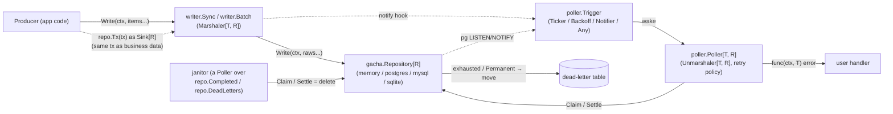
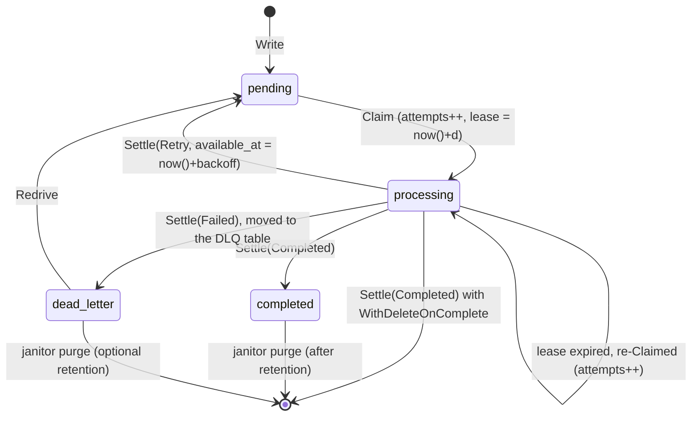

# gacha — agent guide & implementation plan

> **This file is the source of truth for ongoing work.** It holds the plan, the decisions, and the progress log.
> Any agent picking up this module **must** read it first. When you finish an item, tick it, then add a line
> to the [Progress log](#progress-log). Commits are made by the user. Agents only write code.

---

## 1. Goal

`gacha` (module `github.com/zalgonoise/x/gacha`) is a generic library for **batch / long-running operations** built
on the **transactional outbox** pattern. It provides the scaffolding and algorithms to:

1. **Write.** Marshal (slices of) `T` into a raw representation `R` and persist them durably to a repository, the
   "outbox", in a single batch.
2. **Store.** Manage the writes, claims and state transitions of outbox entries, and move exhausted ones to a
   **dead-letter table**. Backends: PostgreSQL, MySQL, SQLite, in-memory, or a user-provided implementation.
3. **Poll.** Run a background worker that decides *when* to claim pending entries, unmarshals them, then calls a
   user-provided `func(ctx, T) error` on each one. The poller's configuration decides what happens on failure:
   retry with backoff, or dead-letter.
4. **Clean up.** Purge completed (and, optionally, dead-lettered) entries on a schedule, using the library's own
   poller.

Every component is a small interface with several interchangeable implementations that share the same method sets.

## 2. Design principles

- **Contracts first.** The root package holds only the small interfaces, value types and codecs. Each responsibility
  lives in its own sub-package.
- **No data loss.** At-least-once delivery. The claim step durably records the attempt *before* the handler runs.
  Entries are only marked `completed` after the handler succeeds. Exhausted entries are *moved*, never dropped: they
  are deleted from the outbox and inserted into the DLQ in one transaction. Crashed or stuck workers are recovered
  through lease expiry. Settles are fenced by the claim's attempt count, so a worker whose lease expired cannot
  overwrite the outcome of the worker that re-claimed the entry (D16). Handlers must be idempotent, and the entry ID
  in the context helps with that.
- **Two type parameters: `T` (the item) and `R` (its raw, stored form).** Writers are built from a `Sink[R]` and a
  `Marshaler[T, R]`. Pollers are built from a `Source[R]` and an `Unmarshaler[T, R]`. Callers can therefore provide
  their own repository *and* their own marshalling, agreeing only on the interfaces. The built-in SQL repositories use
  `R = []byte`. The in-memory repository is generic over `R`, so with the `Identity[T]()` codec it can store `T`
  directly and skip marshalling entirely.
- **`context.Context` everywhere.** It is the first argument of every I/O or blocking call.
- **Performance.** One round-trip per batch for writes and claims, and for settlements when batch-settle is on. Uses
  `FOR UPDATE SKIP LOCKED`, partial indexes, database-side time (`now()` plus an interval, so there is no clock skew),
  slice reuse, and no reflection on hot paths. Hot paths have benchmarks.
- **Function adapters** in the `http.HandlerFunc` style: `gacha.SinkFunc[R]`, `gacha.MarshalerFunc[T, R]`, and so on.
- **Style parity with `github.com/zalgonoise/gbuf`.** Functional options via `github.com/zalgonoise/cfg`
  (`cfg.Option[Config]`, `cfg.Set(defaultConfig(), opts...)`). Structured sentinel errors (Domain / Kind / Entity) in
  `internal/errs`. Doc comments on every exported symbol. `wsl`-style blank lines. `testify/require`. Table-driven
  tests using `for _, testcase := range []struct{...}{...}` with `t.Run(testcase.name, ...)`.

## 3. Architecture



### 3.1 Entry lifecycle



- **Claim** is one atomic statement that **commits** before the handler runs. In PostgreSQL and SQLite:
  `UPDATE outbox SET status='processing', attempts=attempts+1, available_at=now()+$lease, updated_at=now()
  WHERE id IN (SELECT id FROM outbox WHERE status IN ('pending','processing') AND available_at <= now()
  ORDER BY available_at, id LIMIT $n FOR UPDATE SKIP LOCKED) RETURNING id, data, attempts, created_at`.
  This means the attempt count is persisted even if the process crashes or panics mid-handler, so poison messages
  are always caught. In-flight rows hold no transaction and no connection. A `processing` row whose lease has expired
  is eligible again, which is how crashed workers are recovered. `UPDATE ... RETURNING` does not guarantee row order,
  so repositories sort the returned rows by `(available_at, id)` before handing them out.
- **Settle** runs **per item by default**, as soon as that item's handler returns, so a crash never re-runs items that
  already finished. `poller.WithBatchSettle()` instead groups outcomes by kind and writes each group with one bulk
  statement per batch:
  - `Completed` sets `status='completed'` and `available_at=now()`, so the janitor's view lease starts from the
    completion time. With `WithDeleteOnComplete()` the row is deleted instead (D15).
  - `Retry` sets `status='pending'` with `available_at = now()+backoff`.
  - `Failed` runs, in one transaction, `WITH moved AS (DELETE FROM outbox WHERE id = ANY($1) RETURNING ...)
    INSERT INTO outbox_dlq SELECT ...`, recording `last_error` and `failed_at`.
  - `Released` sets `status='pending'`, `attempts = attempts - 1` and `available_at = now()`: the entry is claimable
    right away, and the interrupted claim does not count (D17).
  - Every settle statement is **fenced**: it only matches rows with `status='processing' AND attempts = $attempts`,
    where `$attempts` is the attempt count the claim returned (`Outcome.Attempts`). An outcome for an entry that was
    re-claimed after its lease expired, already settled, or never existed is ignored, not an error (D16).
- **Purge.** Completed rows stay as an audit trail until the janitor deletes them (§3.6), unless the repository was
  built with `WithDeleteOnComplete()`.

### 3.2 Core contracts (root package `gacha`)

```go
// StatusPending, StatusProcessing, StatusCompleted, StatusFailed, StatusReleased (+ String / Parse / text
// marshalling). StatusReleased is an Outcome only: back to pending without counting the claim as an attempt (D17).
// The zero value is not a valid status, so a zero Outcome is rejected instead of silently meaning "retry".
type Status uint8

// Entry is a claimed row as handed to the poller.
type Entry[R any] struct {
    ID        uuid.UUID // stdlib "uuid" (Go 1.27), a UUIDv7 generated by the repository on Write (D14)
    Data      R
    Attempts  int       // includes the current attempt
    CreatedAt time.Time
}

// Outcome is the poller's verdict for a claimed entry.
type Outcome struct {
    ID       uuid.UUID
    Attempts int           // Entry.Attempts of the claim being settled: the fencing token (D16)
    Status   Status        // StatusCompleted, StatusPending (retry), StatusFailed (move to DLQ)
    Err      string        // recorded as last_error when non-empty
    RetryIn  time.Duration // used with StatusPending. The database computes now()+RetryIn.
}

// Sink persists a batch of raw items atomically. Every repository implements it.
type Sink[R any] interface{ Write(ctx context.Context, data ...R) error }
type SinkFunc[R any] func(ctx context.Context, data ...R) error

// Source claims and settles entries. Repositories and repository views (Completed, DeadLetters) implement it.
type Source[R any] interface {
    Claim(ctx context.Context, limit int, lease time.Duration) ([]Entry[R], error)
    Settle(ctx context.Context, outcomes ...Outcome) error
}

type Repository[R any] interface {
    Sink[R]
    Source[R]
}

// Typed, user-facing contracts.
type Writer[T any] interface{ Write(ctx context.Context, items ...T) error }
type Handler[T any] func(ctx context.Context, item T) error

type Marshaler[T, R any]   interface{ Marshal(item T) (R, error) }
type Unmarshaler[T, R any] interface{ Unmarshal(data R) (T, error) }
type Codec[T, R any]       interface{ Marshaler[T, R]; Unmarshaler[T, R] }
// Adapters: MarshalerFunc[T, R], UnmarshalerFunc[T, R], NewCodec(m, u).
// Built-ins: JSON[T]() Codec[T, []byte], Bytes() Codec[[]byte, []byte], String() Codec[string, []byte],
//            Identity[T]() Codec[T, T].

// Permanent marks an error as unrecoverable. The poller dead-letters the entry immediately, without retrying.
func Permanent(err error) error
func IsPermanent(err error) bool

func ContextWithID(ctx context.Context, id uuid.UUID) context.Context // set by the poller
func IDFromContext(ctx context.Context) (uuid.UUID, bool)            // entry ID, e.g. for idempotency keys
```

Type inference keeps call sites short: in `writer.NewSync(repo, gacha.JSON[Order]())`, both `T = Order` and
`R = []byte` are inferred from the arguments.

Optional capabilities, detected through type assertions like `io.WriterTo`:
- `Extender`: `Extend(ctx, lease, ids...)` renews leases. The poller heartbeats long-running handlers with it.
- `Redriver`: `Redrive(ctx, ids...)` moves dead-lettered entries back to `pending` with `attempts = 0`.
- `Stater`: `Stats(ctx) (Stats, error)` returns counts per status, plus the DLQ size.
- `Viewer[R]`: `Completed(retention)` and `DeadLetters(retention)` return the views of §3.6.

### 3.3 Writers (package `writer`): all implement `gacha.Writer[T]`

Constructors take a `gacha.Sink[R]`, which can be a repository, a tx-bound repository, or any `gacha.SinkFunc[R]`,
plus a `gacha.Marshaler[T, R]`.

| Implementation | Behaviour |
| :--- | :--- |
| `writer.NewSync(sink, m, opts...)` | Marshals and writes the whole `[]T` in one call. Splits inputs larger than `MaxBatchSize` into chunks, retries transient errors (optional), and calls notify hooks after a successful write. |
| `writer.NewBatch(sink, m, opts...)` | The "batcher" (group commit). Coalesces **concurrent** `Write` calls into one `Sink.Write`, flushing on `MaxBatchSize` or `Linger`. Each caller blocks until its batch is persisted and gets that batch's error. Provides `Close(ctx)`. |

Both return only after the data is persisted. There is no non-durable writer (Q1).

Options (`cfg.Option[writer.Config]`): `WithMaxBatchSize(n)` (Sync: chunk size, none by default; Batch: flush
threshold, 1000 by default; a single Batch call is never split), `WithLinger(d)` (Batch only; 0 by default, so writes
coalesce only while a flush is in flight), `WithFlushTimeout(d)` (Batch only; flushes run detached from callers'
contexts), `WithRetry(retries, backoff func(retry int) time.Duration)` (skips `Permanent` and context errors; accepts
`poller.Exponential` and friends) and `WithNotify(fns...)`. Marshal failures return `writer.ErrMarshal` and write
nothing. `Batch.Write` after `Close` returns `writer.ErrClosed`. A Batch caller whose context ends before its request
is queued writes nothing; one whose context ends while waiting for the flush may still be persisted.

**Outbox in the caller's transaction.** Every SQL repository exposes `repo.Tx(tx)`, which returns a
`gacha.Sink[[]byte]` bound to the caller's transaction (`pgx.Tx` for Postgres, `*sql.Tx` for MySQL and SQLite).
Wrap it in a writer: `writer.NewSync(repo.Tx(tx), gacha.JSON[Order]()).Write(ctx, orders...)`.

### 3.4 Repositories: one package per backend, all implement `gacha.Repository[R]`

| Package | `R` | Driver | Claim | Bulk write |
| :--- | :--- | :--- | :--- | :--- |
| `memory` | any | none | Mutex plus an ordered index. Same semantics, including leases and DLQ. Reference implementation for tests and dev. | append |
| `postgres` | `[]byte` | `github.com/jackc/pgx/v5` (`pgxpool`) | Single `UPDATE ... WHERE id IN (SELECT ... FOR UPDATE SKIP LOCKED) RETURNING`. | `INSERT ... SELECT unnest($1::bytea[])` (one round-trip, any size) |
| `mysql` | `[]byte` | `github.com/go-sql-driver/mysql` (MySQL ≥ 8.0, or MariaDB ≥ 10.6, for `SKIP LOCKED`) | Short tx: `SELECT ... FOR UPDATE SKIP LOCKED`, then `UPDATE ... WHERE id IN (...)`, then `COMMIT`. MySQL has no `UPDATE ... RETURNING`. | Multi-row `VALUES (?),(?)…`, chunked under the placeholder limit |
| `sqlite` | `[]byte` | `modernc.org/sqlite` (pure Go) via `database/sql` | Single `UPDATE ... WHERE id IN (SELECT ... LIMIT n) RETURNING`. The writer lock makes it atomic, so it needs no `SKIP LOCKED`. | Multi-row `VALUES`, chunked |

- **The table name is a required constructor argument** (e.g. `postgres.New(pool, "orders_outbox", opts...)`). The
  DLQ table defaults to `<table>_dlq` and can be overridden with `WithDeadLetterTable`. Requiring the name prevents
  two streams of different `T` from silently sharing a default table (Q4).
- `WithDeleteOnComplete()` (every backend, including `memory`): `Settle(Completed)` deletes the row instead of
  marking it `completed`. Use it for streams that need no audit trail. It saves the janitor's purge write per row,
  and the `Completed` view is then always empty (D15).
- Other options: `WithNotify(channel)` (Postgres `pg_notify` on write, plus a `postgres.Listener` trigger).
- Every SQL package provides `Migrate(ctx)` and an exported `Schema(table, dlqTable) (string, error)`. Constructors
  return `(*Repository, error)` and reject invalid table names (`ErrInvalidTable`). They never touch the database.
- **IDs are UUIDv7, generated in Go by the repository on `Write`** (`uuid.NewV7()`), never by the database. This
  works the same on every backend (Postgres only gained `uuidv7()` in v18, MySQL and SQLite have none). Storage:
  `UUID` in Postgres, `BINARY(16)` in MySQL, `BLOB` in SQLite. The IDs are time-ordered, so B-tree inserts stay
  append-mostly, and `id` already sorts by creation time: no separate `created_at` index is needed (D14).
- **Indexes match the claim predicate.** The claim filters on `status IN ('pending','processing') AND available_at
  <= now()` and sorts by `(available_at, id)`. Postgres and SQLite use a partial index on `(available_at, id)` over
  the claimable statuses, so the scan stops after `LIMIT` rows. MySQL has no partial indexes. A
  `(status, available_at, id)` index would split `status IN (...)` into two ranges, forcing a filesort of every
  claimable row. MySQL therefore emulates partial indexes with stored generated columns: `claim_at =
  IF(status = 'completed', NULL, available_at)` and `completed_at = IF(status = 'completed', updated_at, NULL)`, indexed
  as `(claim_at, id)` and `(completed_at, id)`. NULLs fall outside the `<=` ranges, so the scans come back in index
  order and stop at `LIMIT` (verified with `EXPLAIN` on MySQL 8.4 and MariaDB 11.8).

**PostgreSQL specifics (as built).**
- `postgres.New(db postgres.DB, table, opts...)`. `DB` is the `Exec` / `Query` / `QueryRow` subset of `*pgxpool.Pool`,
  which `*pgx.Conn` and `pgx.Tx` also satisfy. `repo.Tx(pgx.Tx)` returns the transactional sink.
- Every operation is **one statement**. `Settle` uses three data-modifying CTEs (completed or deleted, retried, failed
  then moved to the DLQ by `DELETE ... RETURNING` feeding `INSERT`), so any mix of outcomes is atomic in one
  round-trip. Outcomes are de-duplicated in Go first (the first one per ID wins), because a statement cannot modify
  the same row twice. Durations are `interval` parameters. `last_error` keeps its previous value when `Err` is empty.
- `Migrate` prefixes the schema with `pg_advisory_xact_lock`. A multi-statement simple query is one transaction, so
  concurrent migrations from several instances are safe. The `gacha_status` enum is shared by all outbox tables.
- Parameters use pgx's fast-path types (`[]pgtype.UUID`, `[]pgtype.Interval`, and scans into `*[16]byte`) rather than
  `uuid.UUID`. pgx still allocates once per array element in its generic slice encoder (about 2 allocations per
  written entry), which is negligible next to the round-trip.
- `postgres.NewListener(pool, channel, opts...)` is a `poller.Trigger`. Its `Run(ctx)` hijacks one pool connection,
  `LISTEN`s on it, and reconnects with backoff (`WithReconnect`). It fires once on every (re)connect, to catch up on
  notifications missed while it wasn't listening. Pair it with a `Ticker` through `poller.Any` for retries.
- Query plan, verified by `TestClaim_UsesIndex`: `Limit → LockRows → Index Scan using <table>_claim_idx`.

**MySQL / MariaDB specifics (as built).**
- `mysql.New(db *sql.DB, table, opts...)`, with `repo.Tx(*sql.Tx)` as the transactional sink. Supports MySQL ≥ 8.0 and
  MariaDB ≥ 10.6 with the same SQL. Everything is portable: no `RETURNING`, no `VALUES ROW(...)`, no `CREATE INDEX IF
  NOT EXISTS` (indexes are declared inline in `CREATE TABLE IF NOT EXISTS`).
- **Time** is `UTC_TIMESTAMP(6)`, evaluated once per statement and independent of the session's time zone, stored in
  `DATETIME(6)`. Durations travel as microseconds (`INTERVAL ? MICROSECOND`). `parseTime` is not required: scanners
  accept `time.Time`, `[]byte` and `string`.
- **Transactions run at READ COMMITTED**, so locking reads take no gap locks that would block concurrent writers.
  - A **claim** is a transaction: `SELECT ... ORDER BY claim_at, id LIMIT ? FOR UPDATE SKIP LOCKED`, then `UPDATE ...
    WHERE id IN (...)`. The returned attempt counts are incremented in Go.
  - A **settle** joins the outbox to a `UNION ALL` derived table of `CAST` parameters, giving an `eq_ref` join on
    `PRIMARY`. It runs one statement per status group: a single statement on its own (autocommit), several in one
    transaction.
  - **Dead letters** are locked with `SELECT ... FOR UPDATE` before the `INSERT ... SELECT`, because at READ COMMITTED
    that read doesn't lock, and a concurrent claim could change a row before the `DELETE`. Redrive locks the same
    way.
- **Statement limits:** at most 1000 rows, outcomes or IDs per statement, and 4MiB of data per `INSERT`. A `Write`
  that needs several statements runs them in one transaction, so it stays atomic. `last_error` is `MEDIUMTEXT`, so
  long errors are kept whole.
- **DSN:** `interpolateParams=true` is recommended. Without it, database/sql prepares and closes every statement. The
  conformance suite runs in both modes, and the `CAST`s keep the derived tables typed either way. Also recommended:
  `transaction_isolation=%27READ-COMMITTED%27`. Single statements autocommit at the session's level, and at REPEATABLE
  READ a settle of a missing row takes a gap lock.
- **Transactional sinks** (`Tx`) wrap multi-statement writes in `SAVEPOINT gacha_write`, so a failure rolls back the
  whole write and leaves the caller's transaction usable. SQLite does the same. Leases are rounded up to whole
  microseconds on every SQL backend, so a sub-microsecond lease never becomes an expired one.
- With `parseTime=true` and a non-UTC `loc`, scanned times are rebuilt in UTC, since the stored wall clock is UTC.

**SQLite specifics (as built).**
- `sqlite.New(db *sql.DB, table, opts...)`, with `repo.Tx(*sql.Tx)` as the transactional sink. It works with any
  SQLite ≥ 3.35 driver (it needs `UPDATE ... FROM`, partial indexes and `VALUES` CTEs), and is tested with
  `modernc.org/sqlite`. The package doesn't import a driver. Tables may be qualified with an attached database
  (`aux.orders`), whose name then prefixes the index names, as SQLite requires.
- **Time** is `INTEGER` microseconds since the Unix epoch, computed by the database from `julianday('now')`
  (millisecond precision, evaluated once per statement). Scanning is a plain `time.UnixMicro`, with no parsing.
- **Writes are serialized by SQLite's single writer lock**, so claims need no `SKIP LOCKED`. Multi-statement operations
  (claims, dead-letter moves, redrives, multi-chunk writes, `Migrate`) run in `BEGIN IMMEDIATE` transactions on a
  dedicated `*sql.Conn`. database/sql only begins deferred transactions, and their read locks fail to upgrade under
  WAL contention (`SQLITE_BUSY_SNAPSHOT`, which the busy handler doesn't retry). A connection whose `ROLLBACK` fails
  is discarded with `driver.ErrBadConn`.
- A **claim** is `SELECT ... ORDER BY available_at, id LIMIT ?`, then `UPDATE ... WHERE id IN (...)`. A single
  `UPDATE ... RETURNING` can't do it, because `RETURNING` sees only the new `available_at`, which loses the claim
  order. A **settle** is `WITH i(...) AS (VALUES ...) UPDATE ... FROM i`. The dead-letter move is an `INSERT ...
  SELECT` plus a `DELETE ... WHERE EXISTS`, both inside the immediate transaction.
- **Concurrency and WAL** (also in the package doc):
  - Set `busy_timeout`, so concurrent writers wait instead of failing with `SQLITE_BUSY`.
  - Use `journal_mode(WAL)`, so readers and the writer don't block each other.
  - Keep the default `synchronous=FULL` for durable outbox writes.
  - Don't use network file systems.
  - Under WAL, keep the dead-letter table in the outbox's database file. Transactions across attached databases are
    only atomic across a crash in rollback-journal mode.
  - Use `:memory:` only with `SetMaxOpenConns(1)` (or a shared-cache URI), since each connection otherwise gets its
    own database.

PostgreSQL schema. MySQL uses `ENUM`, `DATETIME(6)`, `BINARY(16)` and the generated `claim_at` / `completed_at`
columns. SQLite uses `TEXT CHECK(...)`, `INTEGER` microseconds and `BLOB`, with the same partial indexes:

```sql
DO $$ BEGIN
    CREATE TYPE gacha_status AS ENUM ('pending', 'processing', 'completed');
EXCEPTION WHEN duplicate_object THEN NULL; END $$;

CREATE TABLE IF NOT EXISTS orders_outbox (
    id           UUID         PRIMARY KEY,           -- UUIDv7, generated by the repository on Write
    data         BYTEA        NOT NULL,
    status       gacha_status NOT NULL DEFAULT 'pending',
    attempts     INTEGER      NOT NULL DEFAULT 0,
    last_error   TEXT,
    created_at   TIMESTAMPTZ  NOT NULL DEFAULT now(),
    updated_at   TIMESTAMPTZ  NOT NULL DEFAULT now(),
    available_at TIMESTAMPTZ  NOT NULL DEFAULT now()  -- retry backoff / lease expiry
);

CREATE INDEX IF NOT EXISTS orders_outbox_claim_idx
    ON orders_outbox (available_at, id) WHERE status IN ('pending', 'processing');
CREATE INDEX IF NOT EXISTS orders_outbox_completed_idx
    ON orders_outbox (updated_at, id) WHERE status = 'completed';

CREATE TABLE IF NOT EXISTS orders_outbox_dlq (
    id           UUID         PRIMARY KEY,           -- original outbox id (kept for traceability)
    data         BYTEA        NOT NULL,
    attempts     INTEGER      NOT NULL,
    last_error   TEXT,
    created_at   TIMESTAMPTZ  NOT NULL,              -- original write time
    failed_at    TIMESTAMPTZ  NOT NULL DEFAULT now(),
    available_at TIMESTAMPTZ  NOT NULL DEFAULT now() -- janitor / consumer lease on the DLQ view
);
```

### 3.5 Poller (package `poller`)

```go
p := poller.New(repo, gacha.JSON[Order](), handle, // handle: func(ctx, Order) error. T and R are inferred.
    poller.WithTrigger(poller.Backoff(10*time.Millisecond, 5*time.Second)),
    poller.WithBatchSize(100),
    poller.WithConcurrency(4),                 // entries of a batch handled in parallel
    poller.WithLease(time.Minute),             // with heartbeat (lease/3) when the repo is an Extender
    poller.WithMaxAttempts(5),                 // exhausted → DLQ
    poller.WithRetryBackoff(poller.Exponential(time.Second, time.Hour)),
    poller.WithHandlerTimeout(30*time.Second),
    // poller.WithBatchSettle(),               // opt-in: one bulk settle per batch instead of per item
)
err := p.Run(ctx)        // blocks until ctx is done, then settles in-flight work gracefully; returns nil
res, err := p.Poll(ctx)  // a single claim → handle → settle iteration (cron jobs, tests)
```

- **Concurrency is per batch.** `WithConcurrency(n)` handles up to `n` entries of a batch in parallel, and a poll
  returns once every entry of its batch is settled. Several pollers (in one process or many) claim in parallel
  safely, thanks to `SKIP LOCKED` and leases. Defaults: batch 100, concurrency 1, lease 1m, max attempts 10, retry
  backoff `Jitter(Exponential(1s, 10m), 0.2)`, trigger `Backoff(100ms, 5s)`, source timeout 10s, drain on.
- Retry backoffs are plain `func(retry int) time.Duration` values: `Constant(d)`, `Exponential(base, limit)` and
  `Jitter(backoff, factor)`. (`poller.Backoff` is the adaptive trigger.)

- **Failure policy lives here, not in the handler.**
  - A handler error, an unmarshal error, a panic (recovered) or a timeout leads to a retry with backoff.
  - The entry is dead-lettered once `MaxAttempts` is reached.
  - The one handler-side escape hatch: an error wrapped with `gacha.Permanent(err)`, or any error for which
    `IsPermanent` reports true, is dead-lettered immediately. An unmarshal failure is also treated as permanent.
  - Entries claimed with `Attempts > MaxAttempts` are dead-lettered *without* running the handler. This is crash-loop
    protection. `WithMaxAttempts(0)` retries forever (for pollers over views).
- `Trigger` interface: `Wait(ctx context.Context, last Result) error`. Implementations:
  - `Ticker(d)`: fixed interval.
  - `Backoff(min, max)`: adaptive. Resets to `min` when work was found and grows exponentially while idle.
  - `NewNotifier()`: event-driven. `Notify()` is a non-blocking, coalescing wake-up, wired to writer hooks or to
    `postgres.Listener`.
  - `Any(triggers...)`: combinator, e.g. a notifier with a ticker as a safety net.
- **Drain mode** (default on): a full batch triggers an immediate re-poll.
- **Calls to the source** (claims, settles, heartbeat extends) are bounded by `WithSourceTimeout`. Claims and settles
  run under `context.WithoutCancel`, so a shutdown neither strands a committed claim nor loses outcomes (D18).
- **Shutdown:** entries not started yet, and entries whose handler fails because of the shutdown, are *released*
  (`StatusReleased`): handed back for an immediate retry without counting the interrupted claim. They are released in
  one final settle per batch. Heartbeats keep running until the batch is fully settled, panics included.
- **Settles:** per item as soon as each handler returns (default), or all at once with `WithBatchSettle()`. A failed
  per-item settle keeps its entry's heartbeat, and is retried in the batch's final settle, which also carries the
  releases. Only a failed final settle is reported in `Result.Err`.
- **Robustness:**
  - A panicking `Unmarshal` is recovered and dead-letters the entry, like an unmarshal error.
  - A heartbeat interval that is not shorter than the lease falls back to a third of it.
  - `Backoff` idle waits are at least 1ms, even with a zero minimum.
  - `Any` ignores nil triggers.
  - A `Trigger` instance serves one poller: pollers sharing one split its wake-ups.
- `Result{Claimed, Completed, Retried, Failed, Err}` is passed to triggers and to an optional `WithObserver` hook.
  `Err` carries `ErrClaim` / `ErrSettle` failures, which do not stop `Run`. Only a failing `Trigger` does.
  `*slog.Logger` support is available through `WithLogger` (errors, recovered panics with stacks, debug poll results).

### 3.6 Views and the janitor (package `janitor`): the library using itself

Repositories expose `gacha.Source[R]` **views** over non-pending rows:
- `repo.Completed(retention)`: `Claim` leases completed rows older than `retention` (by `updated_at`), oldest first.
  It reuses `available_at` as the view lease, so it needs no extra status. `Settle(Completed)` **deletes** the rows.
  `Settle(Retry)` makes them claimable again after `RetryIn`. `Settle(Failed)` leaves them leased until the lease
  expires. Under `WithDeleteOnComplete()` this view is always empty.
- `repo.DeadLetters(retention)`: the same view over the DLQ table (by `failed_at`). With this view, a regular poller
  can alert on, or archive, dead letters. `Settle(Completed)` deletes them. Re-driving into the outbox goes through
  the `Redriver` capability instead.
- View entries report the row's final `Attempts`, so a poller over a view must not apply `MaxAttempts`
  (`poller.WithMaxAttempts(0)`). The janitor does this for you. Views do not fence settles (D16).

`janitor.New(view, archive, opts...)` returns a `*poller.Poller[R, R]`:
`poller.New(view, gacha.Identity[R](), archive, ...)` with a `Ticker(interval)` trigger, `MaxAttempts(0)`, batch
settles (one bulk delete per batch), and `Constant(interval)` retries. A nil `archive` deletes without archiving, but
users can hook in archival (to S3, a cold table, and so on) before deletion. Options: `WithInterval` (1h),
`WithBatchSize` (1000), `WithLease` (5m), and `WithPollerOptions` to pass anything else to the poller.

### 3.7 Shared test suite (package `gachatest`)

`gachatest.TestRepository(t, newRepo func(t *testing.T) gacha.Repository[[]byte])` is a conformance suite that every
backend (and any user implementation) must pass. The generic variant is `gachatest.Suite[R]{...}.Run(t)`, which also
takes the optional hooks: a `Tx` factory, a delete-on-complete repository factory, the lease used by time-dependent
tests, and a `Wrap` hook (e.g. `synctest.Test`, for repositories on the process clock). Optional capabilities
(`Extender`, `Redriver`, `Stater`, `Viewer`) are tested when implemented and skipped otherwise. It covers:
- write/claim/settle round-trip, claim order and limits
- attempts incremented on claim
- leases (no double claim while leased; reclaim after expiry), `Extend`
- retry `available_at` honoured
- completed state, and `WithDeleteOnComplete`
- fenced settles (stale attempts, unknown IDs and settled rows are ignored), invalid outcomes rejected atomically
- DLQ move (atomic), `Redrive`
- `Completed` / `DeadLetters` views and purge
- concurrent claimers without double delivery
- `Tx` sink commit and rollback

### 3.8 Layout

```
gacha/
  AGENTS.md  CLAUDE.md  README.md  Makefile  .golangci.yaml  go.mod
  doc.go  gacha.go  status.go  entry.go  codec.go  permanent.go  context.go  errors.go   (+ _test.go)
  internal/errs/   structured sentinel errors (Domain/Kind/Entity), mirroring gbuf/errs
  writer/          write.go  sync.go  batch.go  config.go  errors.go
  poller/          poller.go  batch.go  config.go  retry.go  trigger.go (Ticker, Backoff, Notifier, Any)  errors.go
  janitor/         janitor.go  config.go
  memory/          repository.go  queue.go  views.go  config.go
  postgres/        repository.go (incl. Tx)  queries.go  schema.go  views.go  listener.go  config.go  errors.go
                   *_integration_test.go  bench_integration_test.go  export_test.go
  mysql/           repository.go (incl. Tx)  sql.go  scan.go  schema.go  views.go  config.go  errors.go
                   *_integration_test.go  bench_integration_test.go  export_test.go
  sqlite/          repository.go (incl. Tx)  sql.go  scan.go  schema.go  views.go  config.go  errors.go
                   sqlite_test.go  bench_test.go  export_test.go   (in-process, no build tag)
  gachatest/       conformance suite
  examples/        runnable programs: postgres-outbox (needs GACHA_POSTGRES_DSN), batch-writer, notifier, janitor,
                   redrive (memory / SQLite, run in about a second)
```

## 4. Conventions

- Go `1.27.1`. Dependencies: `github.com/zalgonoise/cfg`, `github.com/stretchr/testify`, `github.com/jackc/pgx/v5`,
  `github.com/go-sql-driver/mysql`, `modernc.org/sqlite`, and for tests only
  `github.com/testcontainers/testcontainers-go` (`modules/postgres` and `modules/mysql`). Lint via
  `go tool golangci-lint`, using the same `.golangci.yaml` and `Makefile` targets as gbuf.
- **Unit tests** (`go test ./...`) cover root, writer, poller, janitor, memory and sqlite (in-process).
- **Integration tests** cover postgres and mysql. They use `//go:build integration` and testcontainers-go, and run with
  `make test-integration` (`go test -tags integration ./...`). They need a running Docker daemon: run these commands
  with the sandbox bypassed (the user has pre-approved Docker usage). Each package starts one container in `TestMain`
  and gives every test its own table (`outbox_<n>`, dropped on cleanup). Postgres uses `postgres:18-alpine`. MySQL
  tests start `mysql:8.4` and `mariadb:11.8.6` in parallel and run every test on both, with the conformance suite in
  both DSN modes (interpolated and prepared).
  `.golangci.yaml` sets `build-tags: [integration]`, so these files are linted too. Benchmarks against the container
  live in `bench_integration_test.go`.
- **SQLite tests** run in-process with `modernc.org/sqlite`, with no build tag or Docker. Each test gets a new
  database: a WAL file in `t.TempDir()` with `busy_timeout`, or `:memory:` on one connection. The conformance suite
  runs on both.
- Time-dependent tests (tickers, linger, backoff, leases) use **`testing/synctest`** to make them deterministic and fast.
- Every package ships `example_test.go` and benchmarks for hot paths.
- Before ticking an item, it must pass `go build ./... && go vet ./... && go test -race ./...`, and lint must be clean
  where possible.

## 5. Plan & checklist

### Phase 0: Scaffolding
- [x] 0.1 `go.mod` deps, `Makefile` (plus `test-integration`), `.golangci.yaml` (copied from gbuf), `doc.go`.
- [x] 0.2 `internal/errs` and root `errors.go`.

### Phase 1: Core contracts (`gacha`)
- [x] 1.1 `Status` (String/Parse, text marshalling), `Entry[R]`, `Outcome`.
- [x] 1.2 `Sink[R]` / `SinkFunc[R]`, `Source[R]`, `Repository[R]`, `Writer[T]`, `Handler[T]`, capability
      interfaces (`Extender`, `Redriver`, `Stater`, `Viewer`).
- [x] 1.3 `Marshaler[T, R]` / `Unmarshaler[T, R]` / `Codec[T, R]`, function adapters, `JSON`, `Bytes`, `String`,
      `Identity`.
- [x] 1.4 `Permanent` / `IsPermanent`. Context helpers (`ContextWithID`, `IDFromContext`).
- [x] 1.5 Unit tests.

### Phase 2: In-memory repository and conformance suite
- [x] 2.1 `gachatest` conformance suite (generic over `R`).
- [x] 2.2 `memory.Repository[R]`: write, claim (leases), settle (per-item and bulk, fenced), DLQ move, `Redrive`,
      `Extend`, `Stats`, `Completed` / `DeadLetters` views, `WithDeleteOnComplete`.
- [x] 2.3 `memory` passes `gachatest`. Benchmarks.

### Phase 3: Writers (`writer`)
- [x] 3.1 `Sync` (marshal, chunking, optional retry, notify hooks).
- [x] 3.2 `Batch` (group commit: coalescing, linger, per-caller error fan-out, `Close`).
- [x] 3.3 Tests (synctest) and benchmarks (Sync vs Batch under concurrency).

### Phase 4: Poller (`poller`)
- [x] 4.1 Retry policy (`MaxAttempts`, `Exponential` / `Constant` backoff with jitter, `Permanent` handling).
- [x] 4.2 `Trigger` interface plus `Ticker`, `Backoff`, `Notifier`, `Any`.
- [x] 4.3 `Poller[T, R]`: `Run` / `Poll`, batch size, concurrency, drain mode, unmarshal, panic recovery, handler
      timeout, lease heartbeat, per-item settle (default) and `WithBatchSettle`, graceful shutdown.
- [x] 4.4 Tests (synctest) and an end-to-end test with writer, memory and poller.

### Phase 5: Janitor (`janitor`)
- [x] 5.1 `janitor.New` over the `Completed` / `DeadLetters` views, with archive hook and ticker trigger, plus tests.

### Phase 6: PostgreSQL (`postgres`)
- [x] 6.1 Schema / `Migrate` (outbox and DLQ), config, identifier quoting.
- [x] 6.2 `Write` (unnest) and `Tx(pgx.Tx)` sink.
- [x] 6.3 `Claim`, `Settle` (incl. the atomic DLQ move via a CTE, fencing, `WithDeleteOnComplete`), `Extend`,
      `Redrive`, `Stats`, views.
- [x] 6.4 `pg_notify` on write and a `Listener` trigger.
- [x] 6.5 Integration tests (testcontainers, `gachatest` plus Postgres-specific ones) and benchmarks.

### Phase 7: MySQL (`mysql`)
- [x] 7.1 Schema / `Migrate`, `Write`, `Tx(*sql.Tx)`.
- [x] 7.2 `Claim` (SELECT … SKIP LOCKED, then UPDATE in a short tx), `Settle` (DLQ move in a tx, fencing,
      `WithDeleteOnComplete`), `Extend`, `Redrive`, `Stats`, views.
- [x] 7.3 Integration tests (testcontainers, `gachatest`).

### Phase 8: SQLite (`sqlite`)
- [x] 8.1 Schema / `Migrate`, `Write`, `Tx(*sql.Tx)`.
- [x] 8.2 `Claim`, `Settle` (fencing, `WithDeleteOnComplete`), `Extend`, `Redrive`, `Stats`, views.
- [x] 8.3 Passes `gachatest` in-process. Notes on concurrency and WAL.

### Phase 9: Polish
- [x] 9.1 `README.md`, mirroring gbuf's structure (concept, features, API tables, examples).
- [x] 9.2 `examples/`: Postgres outbox in a business tx, batch writer, notifier-driven poller, janitor, and DLQ redrive.
- [x] 9.3 Lint clean, coverage review (target ≥ 85% on non-driver packages), final API review.

## 6. Decisions

| # | Topic | Decision |
| :--- | :--- | :--- |
| D1 | Claim / settle semantics | Claim uses `UPDATE ... RETURNING` (attempts++, `processing`, lease), committed before the handler runs. Settle marks `completed` / `pending` (retry), or moves the entry to the DLQ. A janitor built on the poller purges completed rows. |
| D2 | Drivers | `pgx/v5` for Postgres. `go-sql-driver/mysql` and `modernc.org/sqlite` via `database/sql`. One package per backend. |
| D3 | Serialization | Generic raw type `R`: `Marshaler[T, R]` on the writer, `Unmarshaler[T, R]` on the poller, `Repository[R]`. The SQL backends use `R = []byte`. `memory` is generic over `R`. |
| D4 | Module layout | Single module `github.com/zalgonoise/x/gacha`, with one sub-package per responsibility. |
| D5 | Integration tests | Go tests with the `integration` build tag, using testcontainers-go. Docker is pre-approved. |
| D6 | Errors | `internal/errs`, mirroring gbuf. |
| D7 | Poller handler | `func(ctx, T) error`. Only the entry ID is available, via `gacha.IDFromContext`. Failure handling is configured on the poller. |
| D8 | Failed entries | Moved atomically to a dead-letter table (`<table>_dlq`). Re-drivable via `Redriver`, observable and purgeable via the `DeadLetters` view. |
| D9 | Writers | `Sync` and `Batch` only. Both are durable on return. No async writer. |
| D10 | Permanent errors | `gacha.Permanent(err)` triggers an immediate DLQ move. Unmarshal errors are permanent. |
| D11 | Settle granularity | Per item by default. `poller.WithBatchSettle()` opts into one bulk settle per batch. |
| D12 | Stream isolation | Table name is a required repository constructor argument. One table (plus its DLQ) per stream. |
| D13 | Ordering | Best-effort FIFO by `(available_at, id)`: fresh entries in write order, retries re-queued at their retry time. Entries from one writer are claimed in write order when nothing is retried. No guarantee with concurrency or retries. Documented. |
| D14 | Entry ID type (Q6) | UUIDv7 via the Go 1.27 standard-library `uuid` package (`uuid.UUID`, `uuid.NewV7()`), so there is no extra dependency. Generated by the repository on `Write`. IDs are unique across streams and processes, survive the DLQ move and redrive unchanged, and sort by creation time (`NewV7` is monotonic within a process). Indexes follow the claim predicate rather than `created_at` (§3.4). |
| D15 | Completed rows (Q7) | Kept as an audit trail by default and purged by the janitor. `WithDeleteOnComplete()` on every repository deletes them at settle time instead. |
| D16 | Settle fencing | `Outcome.Attempts` carries the claim's attempt count. Settles only apply to `processing` rows with that count, so stale outcomes from an expired lease are ignored. Views do not fence (their rows have no live claim to protect). |
| D17 | Release outcome | `StatusReleased`: a fenced hand-back that decrements `attempts`. The poller releases entries a shutdown kept it from handling, so restarts never dead-letter entries that did not get a real attempt. Every backend and the conformance suite support it. On views, it makes the entry claimable right away. |
| D18 | Detached source calls | Claims and settles run under `context.WithoutCancel` plus `WithSourceTimeout`. A claim canceled mid-flight could otherwise commit server-side and strand its entries for a lease. A claim that completes during a shutdown is released. |

### Open questions

None.

## Progress log

- 2026-10-23: Plan drafted.
- 2026-10-23: Review round 1 applied. `UPDATE ... RETURNING` claim with leases, janitor, MySQL, testcontainers,
  `func(ctx, T) error` handler.
- 2026-10-23: Review round 2 applied. Generic raw type `R` (`Marshaler[T, R]`, `Repository[R]`), DLQ table with
  redrive and view, `Permanent` errors, per-item settle by default, required table names, async writer dropped. Q6–Q7
  awaiting answers.
- 2026-10-23: Q6/Q7 answered. D14: UUIDv7 IDs (stdlib `uuid`), claim order `(available_at, id)`. D15:
  `WithDeleteOnComplete()`. D16 added: settles fenced by `Outcome.Attempts`. Completed settles reset `available_at`
  so the janitor's view lease starts at completion.
- 2026-10-23: Phases 0–2 done. Scaffolding (Makefile, lint config, golangci-lint as a go tool), `internal/errs`,
  root contracts (plus `Outcome.Validate`, `Viewer[R]`), `gachatest.Suite[R]` (26 tests, capability-gated) and
  `memory.Repository[R]` (heap claim queue, lists for the views). `memory` passes the suite under synctest, on the real
  clock and with a struct `R`. The suite lives outside `_test.go` files, so `.golangci.yaml` excludes `gachatest/` like
  tests.
- 2026-10-23: Phases 3–5 done. `writer.Sync` (pooled raw slices, chunking, retry, notify) and `writer.Batch`
  (unbuffered request channel for backpressure, linger, overflow carry, `Close` drain); with commits serialized at
  100µs, Batch writes take ~2.9µs/op against Sync's ~129µs/op. `poller` (per-batch concurrency, fenced per-item or
  batch settles, heartbeats, shutdown hand-back, `Ticker` / `Backoff` / `Notifier` / `Any`, `Constant` /
  `Exponential` / `Jitter`) and `janitor` (a configured poller over a view). All tests use synctest except the
  real-clock memory suite. Coverage across the module is ~96%. Next: Phase 6 (PostgreSQL).
- 2026-10-23: Phase 6 done. `postgres.Repository` (single-statement write, claim, settle, extend, redrive and views;
  advisory-locked `Migrate`; fast-path pgx parameter types), `Tx` sink, `WithNotify` plus `Listener` (hijacked
  connection, reconnect with backoff, catch-up fire). Integration tests on `postgres:18-alpine`: the full `gachatest`
  suite (26 tests, none skipped), concurrent `Migrate`, schema-qualified and custom DLQ tables, `last_error`, nil data,
  notify in and out of transactions, listener reconnect after `pg_terminate_backend`, the claim index plan, and 3
  pollers × 4 workers over 500 batch-written entries with no double delivery. Coverage is 90.8%. Benchmarks via Docker
  Desktop: writes of 1000 rows take ~2.5ms (~400k entries/s). A write, claim and settle cycle of 100 takes ~3.0ms with
  one bulk settle, against ~35ms with per-item settles (~12×). Next: Phase 7 (MySQL).
- 2026-10-23: Phase 7 done. `mysql.Repository` for MySQL 8.4 and MariaDB 11.8 with one portable SQL dialect: partial
  indexes emulated with generated columns (`claim_at`, `completed_at`), `UTC_TIMESTAMP(6)` time, READ COMMITTED claim
  and settle transactions, settles as `CAST` derived-table joins, locked dead-letter moves and redrives, chunked
  atomic writes. On both servers: the full `gachatest` suite in both DSN modes (104 runs, none skipped), concurrent
  `Migrate`, qualified and custom DLQ tables, long UTF-8 `last_error`, 2,500-row and 6MiB writes, nil data, `EXPLAIN`
  checks (claim: `range` on `claim_idx`, no filesort; settle: `eq_ref` on `PRIMARY`), and 3 pollers × 4 workers over
  300 entries with no double delivery. Coverage is 94.2%. Benchmarks via Docker Desktop: writes of 1000 rows take
  ~8.2ms on MySQL and ~5.8ms on MariaDB. Single-row commits are ~750µs on MySQL (binlog with `sync_binlog=1` by
  default) against ~210µs on MariaDB. A cycle of 100 takes ~7–9ms with one bulk settle, against ~60–80ms per item.
  Next: Phase 8 (SQLite).
- 2026-10-23: Phase 8 done. `sqlite.Repository` (driver-agnostic, tested with `modernc.org/sqlite`): INTEGER microsecond
  times from `julianday('now')`, partial indexes, `BEGIN IMMEDIATE` transactions on dedicated connections, `VALUES` CTE
  settles, attached-database tables. The full `gachatest` suite passes on a WAL file and on `:memory:` (52 runs, none
  skipped). Also tested: concurrent `Migrate`, attached databases, nil data, long UTF-8 `last_error`, 2,500-row writes,
  `EXPLAIN QUERY PLAN` checks (claim and both views search their partial index with no temp B-tree; settle searches
  the primary key), and 3 pollers × 4 workers over 300 entries with no double delivery. Coverage is 94.6%. Benchmarks
  (WAL, synchronous=FULL): writes of 1000 rows take ~2.7ms (~375k entries/s). A cycle of 100 takes ~1.1ms with one
  bulk settle (~88k entries/s), against ~8.9ms per item. Next: Phase 9 (README, examples, final review).
- 2026-10-23: Phase 9 done.
  - README.md follows gbuf's structure. There are five runnable examples, and `postgres-outbox` was verified against a
    real container. `make bench-integration` is new.
  - Coverage: root 100%, writer 97.6%, poller 97.3%, janitor 91.9%, memory 98.2%, gachatest 95.8%; backends 90–95%.
  - The final review used an independent subagent. Its findings were fixed:
    - D17 `StatusReleased`: shutdown hand-backs used to cost an attempt, so a restarted poller could dead-letter entries
      that never ran.
    - Unmarshal panics are recovered.
    - Heartbeats are deferred, so they also cover the final and batch settles.
    - Failed per-item settles are retried at the end of the batch.
    - D18: claims and settles are detached from cancellation and bounded by `WithSourceTimeout`, which replaces
      `WithSettleTimeout`.
    - `Backoff(0, max)` no longer busy-loops, and `Any` ignores nil triggers.
    - Heartbeat intervals are clamped below the lease, and leases rounded up to whole microseconds on SQL backends.
    - MySQL and SQLite `Tx` writes use savepoints.
    - MySQL `CreatedAt` is rebuilt in UTC under `parseTime` with a non-UTC `loc`.
    - Docs cover MySQL autocommit isolation (`transaction_isolation` in the DSN), SQLite cross-database DLQs under WAL,
      `postgres.DB` usage, Listener pool sizing, and `WithRetry` with transactional sinks.
  - New tests cover each fix, and the whole module passes with `-race -tags integration`.
  - Left as designed: `internal/errs` matches errors on shared Kind and Entity values, as gbuf does (D6).
