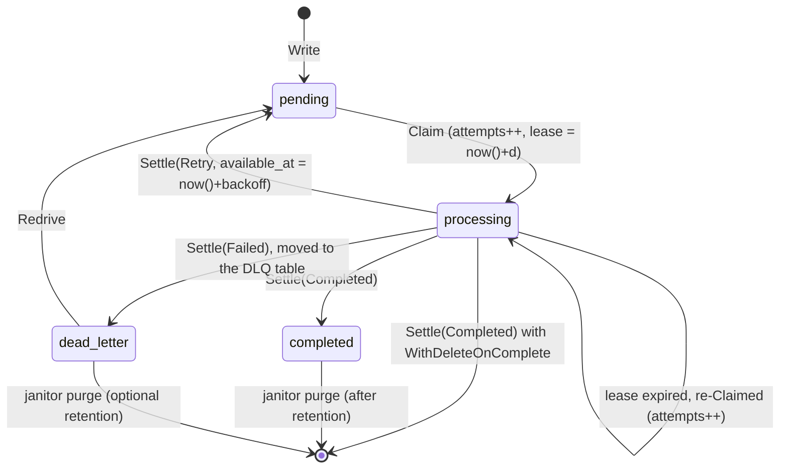

# gacha

*A generic transactional outbox for Go: durable batch writes, leased polling, retries and dead letters, over any
repository.*

---

## Concept

A service that updates its database *and* notifies another system has a dual-write problem. If it writes to the
database and then publishes, a crash between the two loses the message. If it publishes first, a rollback leaves the
consumer with a message about something that never happened. The **transactional outbox** pattern fixes this: the
message is written to an *outbox* table in the same transaction as the business data, and a background worker
delivers it afterwards, retrying until it succeeds.

**`gacha`** implements the whole pattern as a library of small, interchangeable components:

1. **Write** items of any type `T`, marshaled into a raw form `R`, to a repository in one durable batch, optionally
   inside the caller's transaction.
2. **Store** them in PostgreSQL, MySQL / MariaDB, SQLite, memory, or your own repository.
3. **Poll** the outbox in the background, claiming entries with leases and handing each one to a
   `func(ctx, T) error`. A failure policy decides between a retry with backoff and a move to a **dead-letter table**.
4. **Clean up** completed and dead-lettered entries on a schedule, with the same poller.

Key design principles:

1. **No data loss, at-least-once delivery.** A claim durably records the attempt before the handler runs, so a crash
   or a panic is always accounted for. Crashed workers are recovered when their lease expires. Settles are *fenced* by
   the claim's attempt count, so a worker whose lease expired cannot overwrite the outcome of the worker that took
   over. Exhausted entries are *moved* to the dead-letter table in one atomic step, never dropped.
2. **Contracts first, two type parameters.** Writers take a `Sink[R]` and a `Marshaler[T, R]`. Pollers take a
   `Source[R]` and an `Unmarshaler[T, R]`. You can bring your own repository *and* your own encoding. Type inference
   keeps call sites short: `writer.NewSync(repo, gacha.JSON[Order]())`.
3. **The database is the clock, and one round-trip does the job.** Leases and retries use database time (`now()`
   plus an interval), so they are immune to clock skew. Writes, claims and bulk settles are a single statement (or
   one short transaction) per batch. Claims use `FOR UPDATE SKIP LOCKED` (or SQLite's writer lock) and indexes that
   match their predicate exactly.
4. **One conformance suite.** Every repository, yours included, passes the same `gachatest` suite: leases, fencing,
   retries, dead letters, redrive, views and concurrent claimers.

---

## Installation

```bash
go get github.com/zalgonoise/x/gacha
```

Requires **Go 1.27** (entry IDs are UUIDv7 from the standard library's `uuid` package). The backends depend on
[`pgx/v5`](https://github.com/jackc/pgx) (PostgreSQL) and [`go-sql-driver/mysql`](https://github.com/go-sql-driver/mysql)
(MySQL / MariaDB). The SQLite repository works with any `database/sql` SQLite driver, and is tested with
[`modernc.org/sqlite`](https://pkg.go.dev/modernc.org/sqlite).

---

## Features

- **Writers** (`writer`), both durable on return:
  - `Sync`: one `Sink.Write` per call, with optional chunking, retries with backoff, and notify hooks.
  - `Batch`: group commit. It coalesces concurrent `Write` calls into shared writes, flushing on size or linger time.
    Every caller waits for its batch and gets its error. Each call's items are never split across flushes.
- **Poller** (`poller`):
  - Batch claims with leases, per-batch handler concurrency, drain mode, handler timeouts, recovered panics, and
    lease heartbeats for long handlers.
  - Per-item settles by default, or one bulk settle per batch (`WithBatchSettle`). A failed per-item settle is retried
    with the rest of the batch.
  - A graceful shutdown settles in-flight work and *releases* the unfinished entries: it hands them back for an
    immediate retry, without counting the interrupted attempt, so a shutdown never pushes an entry towards the
    dead-letter table.
  - Failure policy: `WithMaxAttempts`, `Exponential` / `Constant` / `Jitter` retry backoffs, and `gacha.Permanent`
    errors for an immediate dead-letter.
  - Triggers: `Ticker`, adaptive `Backoff`, event-driven `Notifier` (and `postgres.Listener`), and `Any` to combine
    them.
- **Janitor** (`janitor`): a poller over a repository's `Completed` or `DeadLetters` view that archives, then deletes.
- **Repositories**, all implementing `Extender` (lease renewal), `Redriver` (DLQ → outbox), `Stater` (counts) and
  `Viewer` (completed / dead-letter views):
  - `memory`: generic over `R`, the reference implementation. With `gacha.Identity`, it stores your items
    themselves.
  - `postgres`: single-statement operations, partial indexes, a transactional sink (`Tx(pgx.Tx)`), `pg_notify` on
    write, and a `Listener` trigger.
  - `mysql`: MySQL ≥ 8.0 and MariaDB ≥ 10.6 with one SQL dialect. READ COMMITTED claim transactions, and partial
    indexes emulated with generated columns.
  - `sqlite`: SQLite ≥ 3.35, partial indexes, `BEGIN IMMEDIATE` transactions, attached databases.
  - `WithDeleteOnComplete()` on every backend, for streams that need no audit trail.
- **Codecs**: `JSON[T]`, `Bytes`, `String`, `Identity[T]`, or any `MarshalerFunc` / `UnmarshalerFunc`.
- **Conformance suite** (`gachatest`) for your own repositories.

---

## How It Works



Each stream has its own outbox table (the name is a required argument, so two streams never share a table by
accident) and its own dead-letter table, `<table>_dlq` by default. Entries are claimed oldest-available first: in write
order, with retries re-queued at their retry time. Ordering is best-effort FIFO, with no guarantee under concurrency or
retries.

Handlers must be **idempotent**, since an entry can run more than once (after a crash, or a lease that expired while
the handler was still running). The entry's ID, from `gacha.IDFromContext(ctx)`, makes a good idempotency key.

---

## API Reference

### Core contracts (`package gacha`)

| Type / Function | Description |
| :--- | :--- |
| `Sink[R]` (`Write(ctx, data ...R) error`)<br>`SinkFunc[R]` | Persists a batch of raw items atomically. Implemented by every repository and by transactional sinks. |
| `Source[R]` (`Claim(ctx, limit, lease)`, `Settle(ctx, outcomes...)`) | Claims entries with a lease, and applies outcomes atomically and fenced. Implemented by repositories and their views. |
| `Repository[R]` | `Sink[R]` + `Source[R]`. |
| `Writer[T]` (`Write(ctx, items ...T) error`) | Typed writer, implemented by `writer.Sync` and `writer.Batch`. |
| `Handler[T]` (`func(ctx, item T) error`) | Processes one item. |
| `Entry[R]` (`ID`, `Data`, `Attempts`, `CreatedAt`) | A claimed entry. `ID` is a `uuid.UUID` (v7). |
| `Outcome` (`ID`, `Attempts`, `Status`, `Err`, `RetryIn`) | The verdict for a claimed entry. `Attempts` is the fencing token. |
| `Status` (`StatusPending`, `StatusProcessing`, `StatusCompleted`, `StatusFailed`, `StatusReleased`)<br>`ParseStatus` | Entry state, or outcome verdict. `StatusReleased` is an outcome only: it hands the entry back without counting the claim as an attempt. Implements `encoding.TextMarshaler`. The zero value is invalid. |
| `Extender`, `Redriver`, `Stater` (`Stats`), `Viewer[R]` (`Completed`, `DeadLetters`) | Optional repository capabilities. |
| `Marshaler[T, R]`, `Unmarshaler[T, R]`, `Codec[T, R]`<br>`MarshalerFunc`, `UnmarshalerFunc`, `NewCodec` | Encoding between items and their stored form. |
| `JSON[T]()`, `Bytes()`, `String()`, `Identity[T]()` | Built-in codecs. |
| `Permanent(err)`, `IsPermanent(err)` | Marks an error as unrecoverable, so the entry is dead-lettered without retries. |
| `ContextWithID(ctx, id)`, `IDFromContext(ctx)` | The handled entry's ID, set by the poller. |

### Writers (`package writer`)

| Type / Constructor | Options (`cfg.Option[writer.Config]`) | Description |
| :--- | :--- | :--- |
| `Sync[T, R]`<br>`NewSync(sink, marshaler, opts...)` | `WithMaxBatchSize(n)` (chunk size, none by default), `WithRetry(retries, backoff)`, `WithNotify(fns...)` | Writes each call's items directly. Atomic per call unless chunked. |
| `Batch[T, R]`<br>`NewBatch(sink, marshaler, opts...)` | `WithMaxBatchSize(n)` (flush threshold, 1000), `WithLinger(d)` (0), `WithFlushTimeout(d)`, `WithRetry(retries, backoff)`, `WithNotify(fns...)` | Group commit across concurrent callers. `Close(ctx)` flushes pending writes. Returns `ErrClosed` after `Close`. |

### Poller (`package poller`)

| Type / Function | Description |
| :--- | :--- |
| `Poller[T, R]`<br>`New(source, unmarshaler, handler, opts...)` | `Run(ctx) error` polls until `ctx` is done, then returns nil. `Poll(ctx) (Result, error)` runs a single iteration. |
| `Result` (`Claimed`, `Completed`, `Retried`, `Failed`, `Err`) | The outcome of a poll, passed to triggers and observers. |
| `Trigger` (`Wait(ctx, last Result) error`), `TriggerFunc` | Decides when to poll next. |
| `Ticker(d)`, `Backoff(min, max)`, `NewNotifier()` (`Notify()`), `Any(triggers...)` | Fixed rate, adaptive idle backoff, event-driven wake-ups, and their combination. |
| `Exponential(base, limit)`, `Constant(d)`, `Jitter(backoff, factor)` | Retry backoffs: `func(retry int) time.Duration`. |

| Option | Default | Description |
| :--- | :--- | :--- |
| `WithTrigger(t)` | `Backoff(100ms, 5s)` | When `Run` polls. |
| `WithBatchSize(n)` | 100 | Entries claimed per poll. |
| `WithConcurrency(n)` | 1 | Entries of a batch handled in parallel. |
| `WithLease(d)` | 1m | How long claimed entries stay leased. |
| `WithHeartbeat(d)` | lease / 3 | Lease renewal while a batch is handled, when the source is an `Extender`. 0 disables it. |
| `WithMaxAttempts(n)` | 10 | Attempts before an entry is dead-lettered. 0 retries forever. |
| `WithRetryBackoff(fn)` | `Jitter(Exponential(1s, 10m), 0.2)` | Delay before a failed entry can be claimed again. |
| `WithHandlerTimeout(d)` | none | Per-handler deadline. |
| `WithSourceTimeout(d)` | 10s | Bound on each claim, settle and heartbeat. Claims and settles run detached from cancellation. |
| `WithBatchSettle()` | off | One bulk settle per batch instead of one per entry. |
| `WithDrain(bool)` | on | Poll again right away after a full batch. |
| `WithObserver(fn)`, `WithLogger(l)` | none | Per-poll results, and `log/slog` logging. |

### Janitor (`package janitor`)

| Function | Options (`cfg.Option[janitor.Config]`) | Description |
| :--- | :--- | :--- |
| `New(view, archive, opts...) *poller.Poller[R, R]` | `WithInterval(d)` (1h), `WithBatchSize(n)` (1000), `WithLease(d)` (5m), `WithPollerOptions(opts...)` | Archives (when `archive` is non-nil), then deletes the view's entries, with no attempt limit and one bulk delete per batch. |

### Repositories

| Package | Constructor | `R` | Options | Notes |
| :--- | :--- | :--- | :--- | :--- |
| `memory` | `New[R](opts...)` | any | `WithDeleteOnComplete()` | Process clock (works with `testing/synctest`). Not durable. |
| `postgres` | `New(db postgres.DB, table, opts...)` | `[]byte` | `WithDeadLetterTable`, `WithDeleteOnComplete`, `WithNotify(channel)` | `Migrate`, `Schema`, `Tx(pgx.Tx)`. `NewListener(pool, channel, opts...)` is a trigger fed by `LISTEN`. |
| `mysql` | `New(db *sql.DB, table, opts...)` | `[]byte` | `WithDeadLetterTable`, `WithDeleteOnComplete` | `Migrate`, `Schema`, `Tx(*sql.Tx)`. Use `interpolateParams=true` and `transaction_isolation=%27READ-COMMITTED%27` in the DSN. |
| `sqlite` | `New(db *sql.DB, table, opts...)` | `[]byte` | `WithDeadLetterTable`, `WithDeleteOnComplete` | `Migrate`, `Schema`, `Tx(*sql.Tx)`. Set `busy_timeout` and WAL for concurrent access, and keep the dead-letter table in the outbox's database file. |

Views: `repo.Completed(retention)` and `repo.DeadLetters(retention)` return a `gacha.Source[R]`. Settling an entry as
completed deletes it, a retry makes it claimable again, and a failure leaves it leased.

---

## Usage Examples

Runnable programs live in [`examples/`](examples): [`postgres-outbox`](examples/postgres-outbox/main.go),
[`batch-writer`](examples/batch-writer/main.go), [`notifier`](examples/notifier/main.go),
[`janitor`](examples/janitor/main.go) and [`redrive`](examples/redrive/main.go).

### 1. Outbox in a PostgreSQL business transaction

```go
repo, err := postgres.New(pool, "orders_outbox", postgres.WithNotify("orders_outbox"))
if err != nil {
	return err
}

if err = repo.Migrate(ctx); err != nil {
	return err
}

// The order and its outbox entry commit, or roll back, together.
err = pgx.BeginFunc(ctx, pool, func(tx pgx.Tx) error {
	if _, err := tx.Exec(ctx, "INSERT INTO orders (id, total) VALUES ($1, $2)", order.ID, order.Total); err != nil {
		return err
	}

	return writer.NewSync(repo.Tx(tx), gacha.JSON[OrderPlaced]()).Write(ctx, OrderPlaced{OrderID: order.ID})
})
```

### 2. An event-driven poller, with a safety net

```go
listener, err := postgres.NewListener(pool, "orders_outbox")
if err != nil {
	return err
}

go listener.Run(ctx)

p := poller.New(repo, gacha.JSON[OrderPlaced](), func(ctx context.Context, event OrderPlaced) error {
	key, _ := gacha.IDFromContext(ctx) // stable across retries

	return mailer.SendConfirmation(ctx, event.OrderID, key)
},
	poller.WithTrigger(poller.Any(listener, poller.Ticker(30*time.Second))),
	poller.WithConcurrency(4),
	poller.WithMaxAttempts(5),
	poller.WithRetryBackoff(poller.Jitter(poller.Exponential(time.Second, time.Hour), 0.2)),
)

return p.Run(ctx) // returns nil once ctx is done and in-flight entries are settled
```

Without PostgreSQL, wire a writer to a `poller.Notifier` instead:
`writer.NewSync(repo, codec, writer.WithNotify(notifier.Notify))`.

### 3. Group commit with `writer.Batch`

```go
w := writer.NewBatch(repo, gacha.JSON[Event](), writer.WithLinger(2*time.Millisecond))
defer w.Close(ctx)

// Called from many goroutines: concurrent calls share repository writes, and each returns once its events are durable.
if err := w.Write(ctx, event); err != nil {
	return err
}
```

`examples/batch-writer` writes 1,600 events from 32 producers to SQLite in 50 transactions instead of 1,600, about 10×
faster.

### 4. Failures, dead letters and redrive

```go
p := poller.New(repo, gacha.JSON[Payment](), func(ctx context.Context, payment Payment) error {
	if !supported[payment.Currency] {
		// Retrying cannot help: skip the retries and dead-letter the entry now.
		return gacha.Permanent(fmt.Errorf("%w %s", errUnsupportedCurrency, payment.Currency))
	}

	return gateway.Execute(ctx, payment) // other errors are retried with backoff, up to WithMaxAttempts
})

// Later: inspect the dead letters, and redrive them once the bug is fixed.
entries, err := repo.DeadLetters(0).Claim(ctx, 100, time.Minute)
// ...
err = repo.Redrive(ctx, ids...) // back to pending, with attempts reset
```

### 5. Purging with the janitor

```go
// Keep a week of completed entries as an audit trail, then archive and delete them.
purge := janitor.New(repo.Completed(7*24*time.Hour), archiveToS3, janitor.WithInterval(time.Hour))
go purge.Run(ctx)

// Delete dead letters after 30 days, without archiving them.
go janitor.New(repo.DeadLetters(30*24*time.Hour), nil).Run(ctx)
```

### 6. Your own repository

```go
func TestRepository(t *testing.T) {
	gachatest.TestRepository(t, func(t *testing.T) gacha.Repository[[]byte] {
		return newMyRepository(t)
	})
}
```

`gachatest.Suite[R]{...}.Run(t)` covers a custom `R`, transactional sinks, `WithDeleteOnComplete` and timing. Its
`Wrap` hook (for instance `synctest.Test`) makes the time-dependent tests instant for repositories on the process
clock.

---

## Performance Notes

- **Settle in bulk when throughput matters.** Per-item settles (the default) are the safest: a crash never re-runs
  entries that had finished. `poller.WithBatchSettle()` replaces N settles with one. For batches of 100, through
  Docker Desktop, a full write → claim → settle cycle took ~3.0ms against ~35ms on PostgreSQL, ~7ms against ~78ms on
  MySQL, and ~1.1ms against ~9ms on SQLite.
- **Coalesce concurrent writes** with `writer.Batch`: when commits are serialized (WAL flushes, SQLite's writer lock),
  it turns N commits into a handful.
- **MySQL:** set `interpolateParams=true`. Otherwise every statement is prepared and closed, in two extra round-trips.
  Also set `transaction_isolation=%27READ-COMMITTED%27`, so autocommitted settles take no gap locks.
- **SQLite:** use WAL mode and a busy timeout. Keep the default `synchronous=FULL` for durable outbox writes.

---

## Development

```bash
make test               # unit tests, including SQLite (in-process)
make test-integration   # adds PostgreSQL, MySQL and MariaDB through testcontainers (needs Docker)
make bench              # benchmarks of the in-process packages
make bench-integration  # adds the PostgreSQL, MySQL and MariaDB benchmarks (needs Docker)
make lint               # golangci-lint, as a go tool
```

The design, decisions and progress log live in [AGENTS.md](AGENTS.md).

---

## License

This project is licensed under the MIT License. See the [LICENSE](../LICENSE) file for details.
